<h1 align="center">Docs Studio</h1>

<p align="center"><strong>See what your AI coding agent did, why it did it, and whether your docs still tell the truth.</strong><br>
Living docs with animated diagrams and pages scanned from your repo, a hub where every change has a card and every choice a reason, and a report on every pull request. For Claude Code (and Codex).</p>

<p align="center">
  <a href="https://www.npmjs.com/package/docs-studio"></a>
  
  <a href="#pr-report"></a>
  <a href="https://app.netlify.com/start/deploy?repository=https://github.com/rsmed31/docs-studio&base=hub"></a>
  
  <a href="LICENSE"></a>
</p>

Coding agents write more code than their owners can read. A diff shows **what** changed, not **why**, not what was **decided**, not whether the docs are still **true**. Docs Studio closes those loops automatically, with hooks instead of paperwork. Read the full idea in **[VISION.md](VISION.md)**.

| Layer | What you get | Needs |
|---|---|---|
| **Docs** | A living docs site: 20+ diagram presets that animate, pages scanned from the repo on every commit (structure, module graph, git activity, dependencies, TODOs), a status board and a whiteboard. | Python 3.9+ |
| **Hub** *(optional)* | Every project in one place: hooks make Claude claim a board card before editing code, log decisions with reasons, reconcile work done outside the hub, and keep pages current. To-do and brainstorming lists, invitation-only access. | A free Netlify site |
| **PR report** *(optional)* | One comment per pull request: what Claude did and why, decisions, risky files, whether the docs kept up. | A GitHub workflow |

## Install

**Claude Code plugin** (docs skill + hub connector, one step):

```
/plugin install docs-studio --marketplace rsmed31/docs-studio
```

On older Claude Code: `/plugin marketplace add rsmed31/docs-studio`, then `/plugin install docs-studio@docs-studio`.

**Or the skill alone, with npm** (also for Codex):

```bash
npx docs-studio            # Claude Code  ->  ~/.claude/skills/docs-studio
npx docs-studio --codex    # Codex        ->  ~/.codex/skills/docs-studio
```

Then open your agent in any project and say **"document this project with docs-studio"** (Claude Code: `/docs-studio`). That is the only time you have to ask. Want it set up right now? `npx docs-studio init`. More under [Install options](#install-options).

### The hub (optional)

[](https://app.netlify.com/start/deploy?repository=https://github.com/rsmed31/docs-studio&base=hub)

1. Deploy (free tier). Netlify asks for `HUB_SECRET` (32+ random characters) and `HUB_SETUP_CODE` (a one-time code you choose).
2. Open `https://<your-site>/#/setup` and create the owner account with that code.
3. Create a project, open its settings (gear, top right) and copy the `.claude/settings.local.json` block into the project's repository. The plugin's hooks wake up: card before code, decisions and summaries in the traceability log, drift reconciled at the next session, Auto pages after each commit.
4. Authorize teammates under **People with access** (invitation only; removing someone signs them out at once). Who else may enter can also be listed in `hub/netlify/access.mjs`.

### PR report

Add the project token as the repository secret `DOCS_STUDIO_TOKEN`, then `.github/workflows/docs-studio.yml`:

```yaml
name: Docs Studio PR report
on: pull_request
permissions:
  contents: read
  pull-requests: write
jobs:
  report:
    runs-on: ubuntu-latest
    steps:
      - uses: actions/checkout@v5
        with:
          fetch-depth: 0
      - uses: rsmed31/docs-studio@v0
        with:
          hub-url: https://your-hub.netlify.app      # optional: without the hub, the report covers the repository only
          hub-project: your-project
          hub-token: ${{ secrets.DOCS_STUDIO_TOKEN }}
          fail-on-stale-docs: false                  # true: fail when docs/site is out of date
```

<p align="center">
  <picture>
    <source media="(prefers-color-scheme: dark)" srcset="images/gallery-dark.png">
    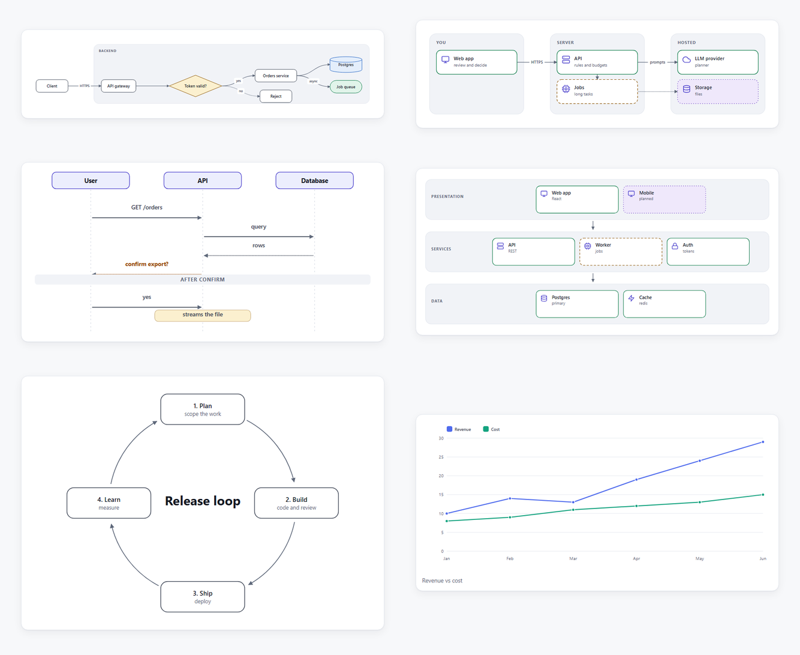
  </picture>
</p>

---

## The problem

Project docs rot. The architecture diagram was right in March. The README describes a folder that no longer exists. Nobody wants to redraw boxes in a drawing tool, and the people (and agents) who join later pay for it.

## The idea

Let the agent that already reads your code **write the docs**, and let the repository **keep the numbers honest**:

- **Claude writes the pages.** It reads your README, manifests and entry points, then writes Markdown pages with diagrams. It asks you when the repo can't answer something.
- **The repo writes the rest.** On every build, scanners derive the folder map, import graph, language stats, git activity, dependencies and TODOs straight from the code, so they cannot drift.
- **Hooks keep it alive.** A git `post-commit` hook rebuilds the docs after every commit. A SessionStart hook starts the server in every Claude Code session and tells Claude when the written pages lag behind the code. (The SessionStart hook is a Claude Code feature. With Codex the git hook still runs, and you start the server yourself with `python docs/site/studio.py start`.)

You call the skill **once per project**. Everything else is automatic.

## See it

### 20+ diagram presets, a few lines of text each

Describe a diagram in plain text; the layout is automatic. Light and dark themes, PNG/SVG export and a full-screen pan/zoom viewer come free.

<table>
<tr>
<td width="50%">

```
:::flow lr
client[Client] -> gw[API gateway]: HTTPS
gw -> auth{Token valid?}
auth -> svc[Orders service]: yes
auth --> deny[Reject]: no
svc -> db[(Postgres)]
svc -> q[[Job queue]]: async
group Backend: gw, auth, svc, q, db
:::
```

</td>
<td width="50%">
<picture>
  <source media="(prefers-color-scheme: dark)" srcset="images/presets/flow-dark.png">
  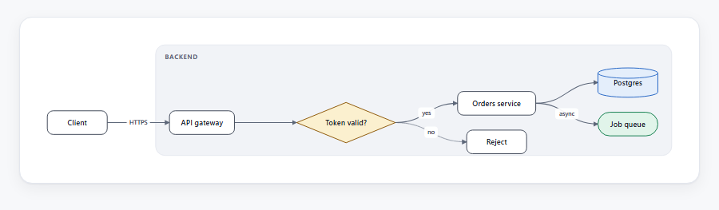
</picture>
</td>
</tr>
<tr>
<td width="50%">

```
:::zones cols=3
## You
- web | monitor | Web app | review and decide | done
## Server
- api | server | API | rules and budgets | done
- jobs | cpu | Jobs | long tasks | running
## Hosted
- llm | cloud | LLM provider | planner | done
web -> api: HTTPS
api -> jobs
api -> llm: prompts
:::
```

</td>
<td width="50%">
<picture>
  <source media="(prefers-color-scheme: dark)" srcset="images/presets/zones-dark.png">
  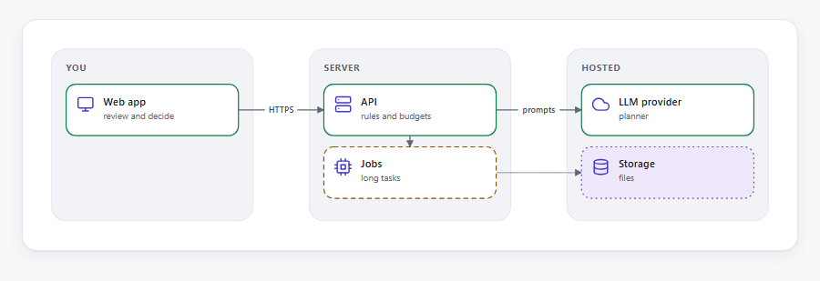
</picture>
</td>
</tr>
<tr>
<td width="50%">

```
:::sequence
User | API | Database
User -> API: GET /orders
API -> Database: query
Database --> API: rows
API --> User: ! confirm export?
== After confirm ==
User -> API: yes
note API: streams the file
:::
```

</td>
<td width="50%">
<picture>
  <source media="(prefers-color-scheme: dark)" srcset="images/presets/sequence-dark.png">
  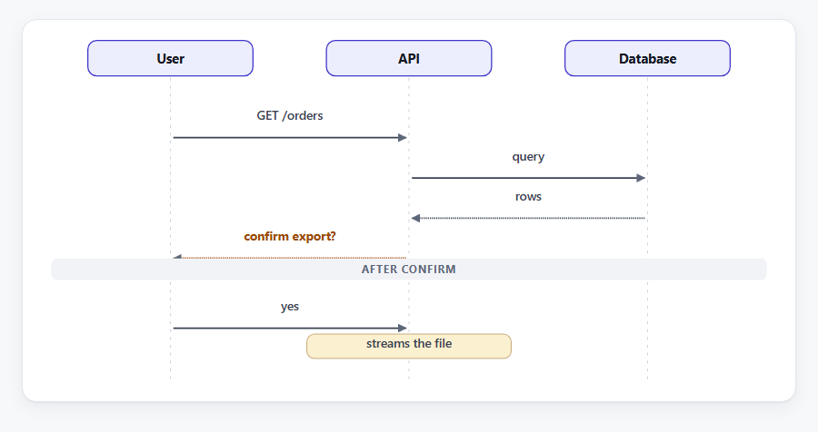
</picture>
</td>
</tr>
</table>

| | Presets |
|---|---|
| **Flows and behaviour** | `flow` · `swimlane` · `sequence` · `state` · `cycle` · `funnel` |
| **Structure** | `zones` (system map) · `layers` (architecture stack) · `tree` · `mindmap` · `er` (schema) · `network` · `pyramid` |
| **Data** | `chart` (line, area, column, stack) · `donut` · `radar` · `heatmap` · `gantt` · `quadrant` · `stats` (KPI tiles with sparklines) |
| **Blocks** | `cards` · `steps` · `timeline` · `bars` · `kanban` · `board` |

<details>
<summary><strong>More presets: swimlane, mind map, Gantt, KPI tiles</strong></summary>
<br>
<picture>
  <source media="(prefers-color-scheme: dark)" srcset="images/presets/swimlane-dark.png">
  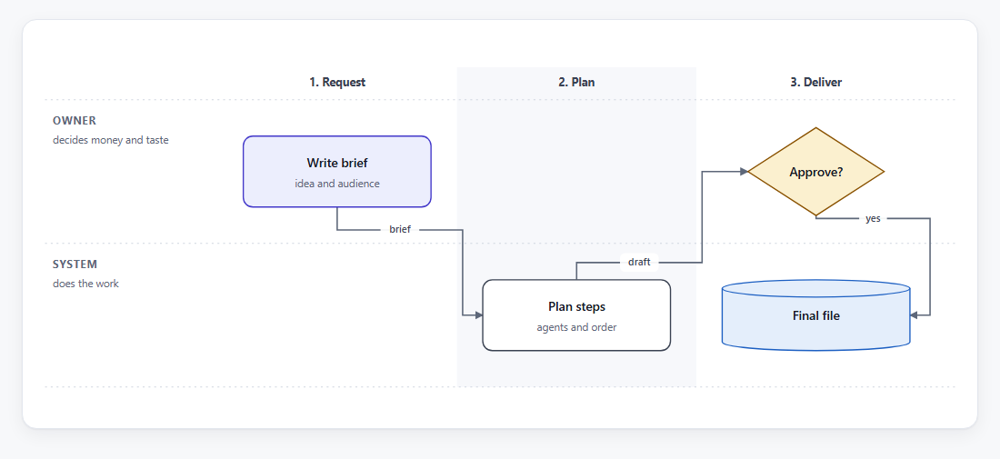
</picture>
<picture>
  <source media="(prefers-color-scheme: dark)" srcset="images/presets/gantt-dark.png">
  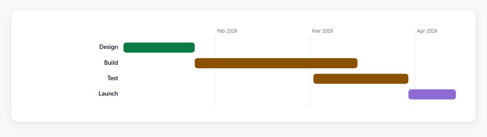
</picture>
<picture>
  <source media="(prefers-color-scheme: dark)" srcset="images/presets/mindmap-dark.png">
  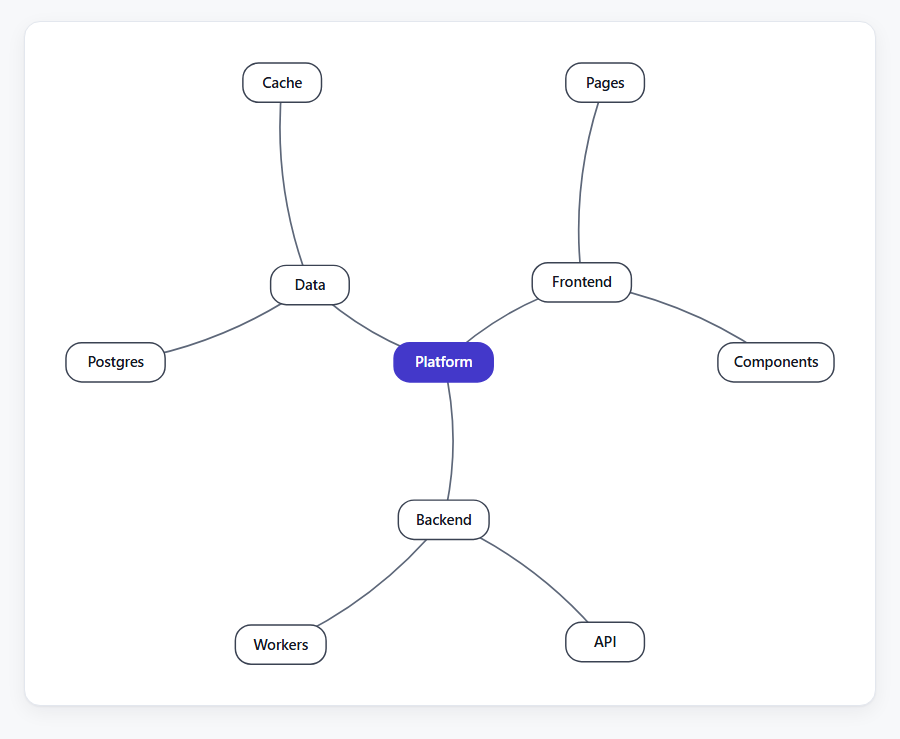
</picture>
<picture>
  <source media="(prefers-color-scheme: dark)" srcset="images/presets/stats-dark.png">
  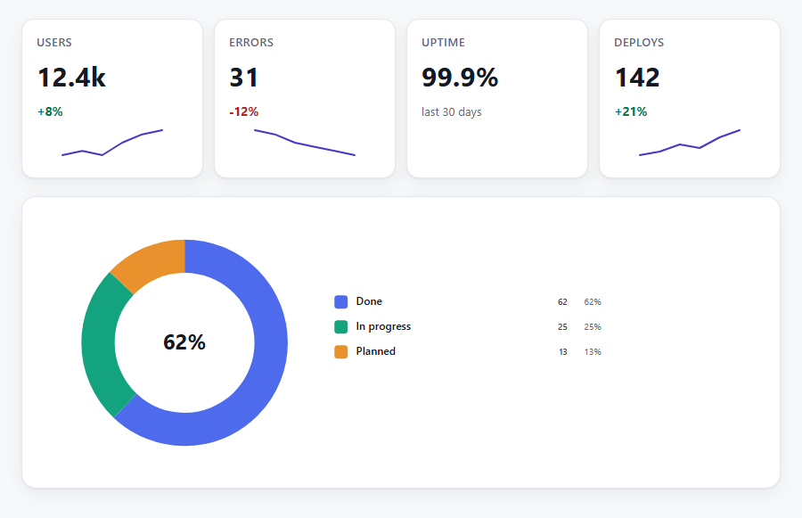
</picture>
</details>

### Animations that explain, not decorate

Add `anim=NAME` to any diagram. Every preset has a sensible default; `static` turns motion off.

| `anim=` | What moves |
|---|---|
| `packets` | dots travel along connections: data moving through a flow |
| `trace` | connections light up one by one, in order, on a loop: walk through a sequence |
| `flow` | dashes march along every line |
| `reveal` | elements fade in one after another when scrolled into view (with a Replay button) |
| `draw` | lines draw themselves, bars and slices grow |
| `pulse`, `glow` | nodes breathe in turn |

Visitors with *reduced motion* see still diagrams. PNG/SVG exports always show the finished picture.

### Pages scanned from your repo, on every commit

No prompt, no config: the **Auto** section is generated from the code each time the docs build.

<picture>
  <source media="(prefers-color-scheme: dark)" srcset="images/site-overview-dark.png">
  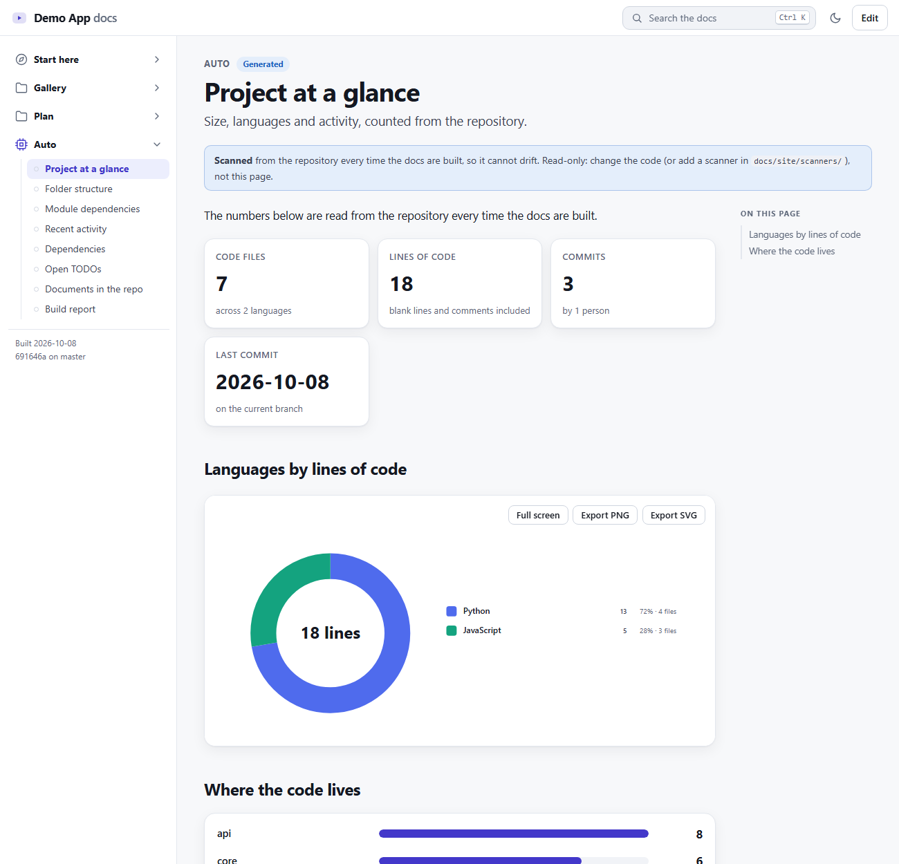
</picture>

Built in: project at a glance · folder structure · **module dependency graph** (Python, JS/TS imports) · git activity · dependencies (package.json, requirements, pyproject, go.mod, Cargo.toml, Gemfile, pubspec) · open TODOs · documents found in the repo. Add your own scanner as a 10-line Python file.

<picture>
  <source media="(prefers-color-scheme: dark)" srcset="images/site-modules-dark.png">
  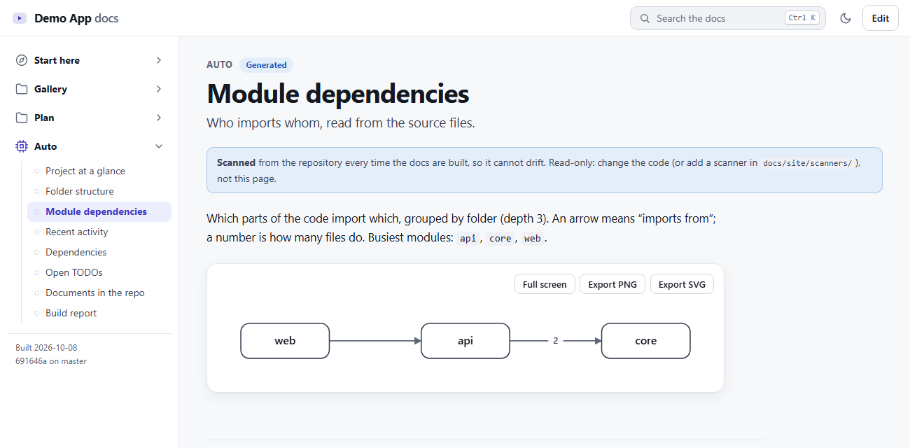
</picture>

### A status board and a whiteboard, saved in the repo

<table>
<tr>
<td width="50%">
<picture>
  <source media="(prefers-color-scheme: dark)" srcset="images/site-board-dark.png">
  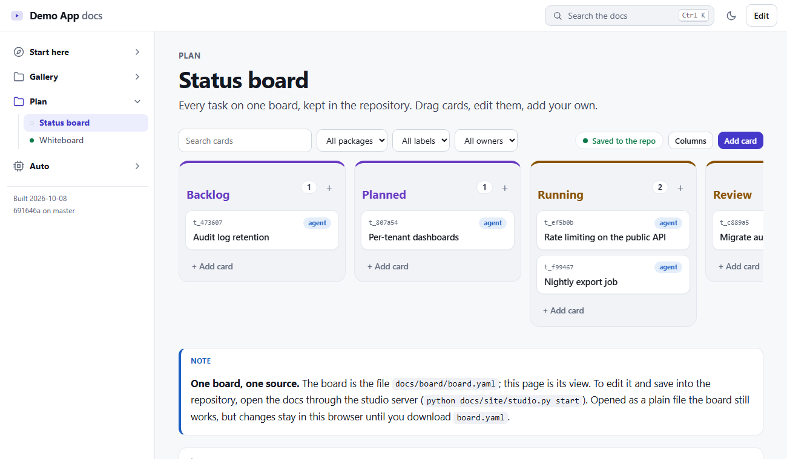
</picture>
</td>
<td width="50%">
<picture>
  <source media="(prefers-color-scheme: dark)" srcset="images/site-whiteboard-dark.png">
  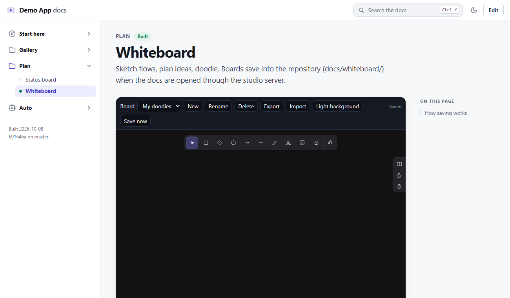
</picture>
</td>
</tr>
</table>

- **Board:** a kanban over `docs/board/board.yaml`. Drag cards, edit them in the browser, or let agents move their own cards from the command line (`python docs/board/board.py move <id> running`).
- **Whiteboard:** Excalidraw, vendored so it works offline. Boards are saved as files in `docs/whiteboard/`; import and export `.excalidraw`.

## How it works

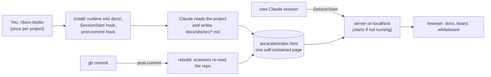

1. **Install** (`scripts/install.py`) copies a small runtime into `docs/`, writes `docs/studio.json`, registers the hooks, builds the site and starts the server. Re-running it updates the runtime and never touches your content.
2. **Claude writes** 3 to 12 pages from what it reads, choosing diagram presets by what each page needs to show, and checks every arrow against the code.
3. **Every commit** rebuilds the site in the background. The commit hook counts how many commits touched the code since the written pages were last reviewed.
4. **Every session** starts the server. When the pages lag behind, Claude is told and offers `refresh`: it reads only the changed areas and updates the pages they affect.

## Install options

**With npm (fastest):**

```bash
npx docs-studio                 # install or update the skill for Claude Code (~/.claude/skills/docs-studio)
npx docs-studio --codex         # ...for Codex (~/.codex/skills/docs-studio)
npx docs-studio --all           # ...for both
npx docs-studio init            # ...and set up the project in the current folder right away
npx docs-studio init --name "My project" --no-git-hook      # init options are passed through
npx docs-studio uninstall       # remove the skill
```

Or install it globally once: `npm install -g docs-studio`, then run `docs-studio` / `docs-studio init`. (`CLAUDE_CONFIG_DIR` and `CODEX_HOME` are respected if you moved those folders.)

**With git:**

```bash
git clone https://github.com/rsmed31/docs-studio.git
cp -r docs-studio/skills/docs-studio ~/.claude/skills/     # Claude Code (Codex: ~/.codex/skills/)
claude --plugin-dir ./docs-studio                           # or try the whole plugin for one session
```

On Windows the skills folder is `%USERPROFILE%\.claude\skills\`. Start a new session, open a project and say:

> document this project with docs-studio

or type `/docs-studio`. That's the only time you have to ask.

**Requirements:** Claude Code or Codex, Python 3.9+ and PyYAML (`python -m pip install pyyaml`; the installer tries it for you). Git is optional (without it you lose the commit hook and the activity scanners). Node 16+ is only needed for the `npx` installer; the skill itself runs on Python alone, with no build step, no network and no CDN.

## Everyday use

Ask Claude in plain language:

| You say | It does |
|---|---|
| "add a sequence diagram of the checkout flow" | picks the preset, writes it into the right page, builds, looks at it |
| "make the data flow animate" | adds `anim=packets` (or `trace`) |
| "refresh the docs" | reads what changed since the last review and updates the affected pages |
| "turn off the docs server" | `studio.py stop` |

Or use the CLI yourself (from the project root):

```bash
python docs/site/studio.py start | stop | status | url   # the server
python docs/site/studio.py build                           # rebuild now
python docs/site/studio.py presets                         # every preset with its syntax
python docs/site/studio.py changes                         # what changed since the pages were reviewed
python docs/site/studio.py hosting netlify                 # publish config (also vercel)
```

## What it adds to your project

```
docs/
  studio.json            settings: name, port, animation default, scan options
  site/
    src/*.md             the pages (written by Claude, edited by you)
    index.html           the built site (one file, opens straight from disk)
    presets_custom/      your own diagram presets   (optional)
    scanners/            your own scanners          (optional)
    ...                  builder, server, theme, presets (updated by re-running install)
  board/board.yaml       the status board
  whiteboard/            saved whiteboards
  .studio/               runtime state (gitignored)
.claude/settings.json    SessionStart hook
.githooks/post-commit    rebuild hook (or appended to your existing hooks)
```

Uninstall with `python ~/.claude/skills/docs-studio/scripts/install.py --project . --uninstall`; it removes both hooks and leaves `docs/` for you to keep or delete.

## Make it yours

**A project-specific diagram** (`docs/site/presets_custom/badges.py`):

```python
from presets.common import preset, svg_open, esc, items, fields

@preset("badges", anim="reveal", syntax="- Label | note")
def badges(ctx):
    rows = [fields(i, 2) for i in items(ctx.body)]
    parts = [f'<g class="pv-n" style="--i:{k}"><rect class="pv-shape" x="{20 + k * 150}" y="20" width="140" height="48" rx="10"/>'
             f'<text class="pv-t" x="{90 + k * 150}" y="50" text-anchor="middle">{esc(r[0])}</text></g>' for k, r in enumerate(rows)]
    return svg_open(40 + len(rows) * 150, 90, "Badges") + "".join(parts) + "</svg>"
```

It is now `:::badges` in any page, themed and animatable.

**A project-specific scanner** (`docs/site/scanners/routes.py`):

```python
def scan(ctx):                      # ctx.files, ctx.read(path), ctx.run(*git_args), ctx.root
    routes = [f"- `{f}`: {l.strip()}" for f in ctx.files if f.endswith(".py")
              for l in ctx.read(f).splitlines() if l.lstrip().startswith("@app.route")]
    if routes:
        return {"id": "routes", "title": "HTTP routes", "group": "Auto", "order": 335,
                "summary": "Every route in the code.", "markdown": "\n".join(routes)}
```

## Design choices

- **Project-agnostic by construction.** The runtime contains no project names, paths or domain knowledge. Content is either written by Claude after reading the repo or scanned at build time.
- **Honest.** Pages mark unbuilt things `planned`; the skill tells Claude to check each arrow against the code and to ask rather than guess.
- **Local and safe.** The server binds to `127.0.0.1`, accepts only local origins and refuses large bodies. The build refuses to write a page that contains something shaped like an API key or private key. Board and whiteboard edits are committed only if you opt in (`"server": {"commit_edits": true}`).
- **Boring output.** One self-contained HTML file that works from disk, in light and dark, on a phone. Search (`Ctrl K`), deep links, copy-as-Markdown editing in the browser.
- **Never in your way.** Hooks swallow their own errors and cannot fail a commit or a session. `SKIP_DOCS_HOOKS=1` skips the commit hook.

## Repository layout

```
.claude-plugin/          plugin.json + marketplace.json (the Claude Code plugin is the repo root)
skills/docs-studio/      the skill: SKILL.md, scripts/install.py, runtime/ (copied into each project's docs/), references/
hooks/hooks.json         hub hooks: card before code, tracking, Auto-page rescans, stop checks (inert without a hub)
.mcp.json                the hub MCP server (board, pages, decisions, drift, lists, scans)
hub-sync/                server/mcp.mjs, hooks/*.mjs, render/hubdoc.py (renders pages with the skill runtime), import_site.py
hub/                     the hosted hub: Netlify Functions + Blobs API, home and project pages (deploy button above)
action.yml, action/      the PR report GitHub Action
bin/cli.js               the npm installer (`npx docs-studio`)
VISION.md                where this is going and why
```

## Credits and license

The whiteboard is [Excalidraw](https://github.com/excalidraw/excalidraw) 0.17.6 with React, both MIT-licensed and vendored under `skills/docs-studio/runtime/site/whiteboard/vendor/` (with the excalidraw.com collaboration key removed, since it is unused when embedded) with their licenses. The rest of this repository is released under the [MIT License](LICENSE).
